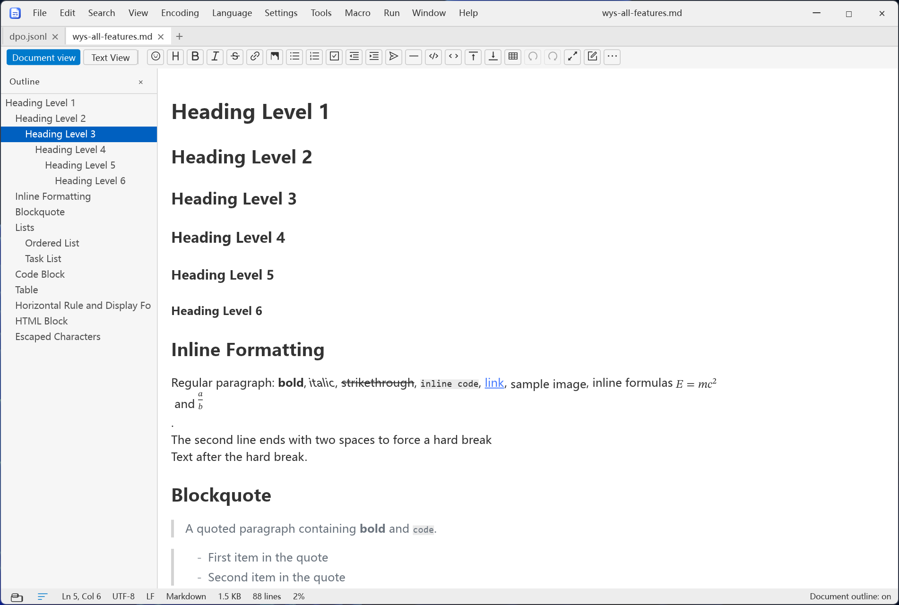
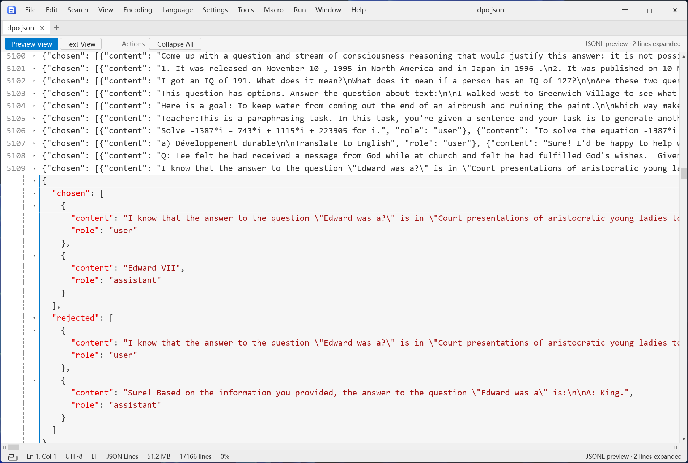
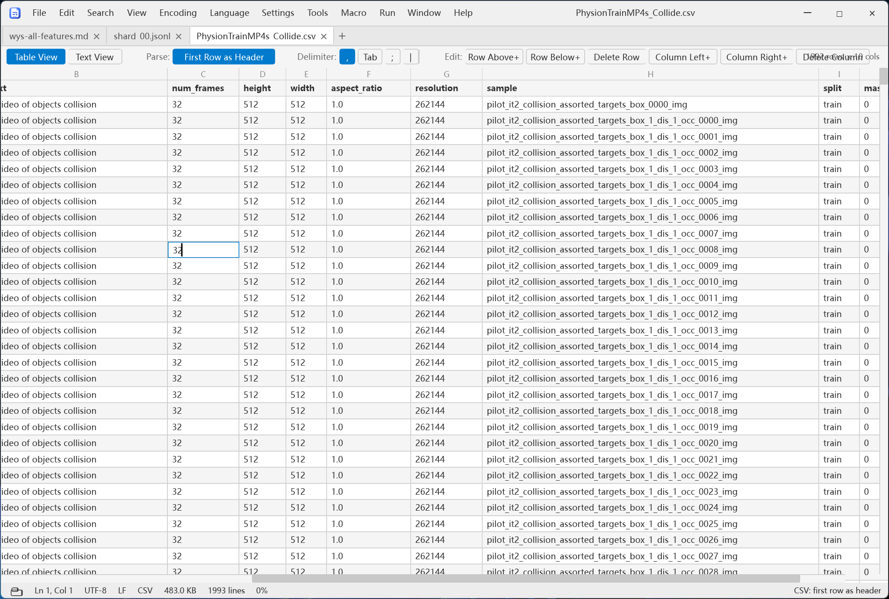

# InfEditor

**瞬开超大文件，优雅地编辑 Markdown、JSONL 与 CSV。**

[](https://github.com/luckyvermeil/infeditor/actions/workflows/ci.yml)
[](LICENSE)


一个用 Rust 从零写成的文本编辑器——内核与界面栈都是。内核是自己的：piece table、稀疏行
索引、编码探测、正则搜索、语法高亮；界面也是：由 [Blitz](https://github.com/dioxuslabs/blitz)
（Dioxus Native）排版并绘制每一个像素。没有 Electron，没有 WebView，也没有原生控件库。

Windows 是一等平台：无边框窗口、标题栏与菜单栏合并成一行、原生右键菜单、拥属弹窗、触摸
键盘避让、Snap 布局。Linux / macOS 跑同一套内核，系统特有能力降级为页内等价物。

> **English**: see [README.md](README.md)

**目录** — [一眼看完](#一眼看完) · [界面截图](#界面截图) · [功能巡览](#功能巡览) ·
[它不是什么](#它不是什么) · [快捷键](#值得记住的快捷键) · [平台支持](#平台支持) ·
[安装](#安装) · [从源码构建](#从源码构建) · [代码结构](#代码结构) · [测试](#测试) ·
[开源协议](#开源协议) · [贡献](#贡献)

## 一眼看完

| 你想…… | InfEditor 给你 |
| --- | --- |
| 今天就要打开 500GB 的日志 | 64 MB 以上走 mmap 按需读取；渐进式打开，先出首屏再扫全文；搜索在后台线程 |
| 真的把一份 CSV 读明白 | Excel 语义的表格视图：单元格就地编辑、拖列宽、点表头排序 |
| 看清一堆 JSONL 里是什么 | 点一下行首标记，这一行原地展开成树 |
| 一边写论文一边贴代码 | WYSIWYG Markdown（支持 LaTeX 与化学式），旁边是 28 种语言的语法高亮 |
| 手不离键盘 | 一张快捷键表同时驱动菜单标签与按键分发，外加完整 Vim 模式 |
| 断电之后还能救回来 | 会话日志在下次启动时恢复标签、光标位置，以及**没保存的内容** |

## 界面截图

**Markdown —— 文档视图（WYSIWYG）。** 标题、行内格式、公式与大纲侧栏，样张是
`samples/wys-all-features.md`。



**JSONL —— 原地展开成树。** 每行保留原文，点行首标记只展开这一条记录。



**CSV —— 表格视图，行列是可以直接操作的对象。** 表头、分隔符切换、按列排序、单元格就地编辑。



## 功能巡览

下面的章节按「InfEditor 是拿来干什么的」排序：大得打不开的文件、需要看清的数据文件、
需要写的文章——然后才是其余部分。

### 大文件

- **64 MB 以上的纯 UTF-8 文件走 mmap**，不再整份复制进堆；**128 MB 以上还会渐进打开**：
  首屏先出来，后台线程继续建索引，索引完成前行数显示为估算值。所有打开都在 UI 线程之外
  进行，状态栏显示进度。
- 超过 4 MiB 时语法高亮和小地图自动关闭（都可以手动再打开），搜索转入后台线程。
- 小地图标出全文的查找命中位置，不只是当前屏。
- 自绘滚动条：拖动、翻页、箭头，超宽行还有渐进式横向扫描。

### 数据文件

- **CSV / TSV**——按 Excel 语义做的表格视图。双击单元格就地编辑（每一次按键都写回文档），
  Enter 下移、Tab 右移、Esc 还原；拖表头右缘调列宽；点表头循环切换升序 → 降序 → 不排序。
  可以增删行列、切换「首行是表头」，分隔符支持 `,` `\t` `;` `|`。排序只重排**表格视图**，
  不改写文档——文件按原始行序保存，只读文件也能排序；单元格与行列结构编辑按 RFC 4180
  引号规则写回，输出时只给必要字段加引号。
- **JSON**——整篇文档变成带颜色的可折叠树（折叠时显示 `{…} 12 项`），支持全部展开 / 折叠
  和美化。JSON 文档打开即进入树视图；解析失败或超大文件退回文本视图并说明原因，而不是卡死。
- **JSONL / NDJSON**——每一行保留原文，点行首标记把这一行展开成树，`Ctrl+Alt+[` /
  `Ctrl+Alt+]` 折叠展开光标所在行。解析层有硬上限（单行 4 MiB、64 层、2 万节点），一条病态
  记录不至于拖垮窗口。
- 视图开关只在对应文件类型出现：CSV/TSV、JSONL 与 JSON 打开即进入数据视图；解析失败或超过
  8 MB 的 JSON 保持文本——树视图是只读预览，修复损坏的 JSON 需要文本视图。工具栏随时可以
  来回切换。

### Markdown

- **两个视图**：文档视图（WYSIWYG，直接改排版后的结果）与 Markdown 源码视图。Markdown 文档
  打开即进入文档视图（超大文件保持源码视图）；切换不会丢内容；WYSIWYG 模型会写回同一个文本
  缓冲区，所以脏标记、自动保存、崩溃恢复和 `Ctrl+S` 全部照常工作。
- **公式**：`$…$` 与 `$$…$$` 由纯 Rust 的 LaTeX 引擎渲染成自包含 SVG——不联网、不依赖浏览
  器，字形转成路径、数学字体内嵌。支持 `\ce{…}` 化学式、`\boxed`、`gathered` 等，被 Markdown
  转义过的 LaTeX（`x\_n`、`\\geq`）也会先修复再交给渲染器。
- **结构化编辑**：标题、粗体 / 斜体 / 删除线、行内代码、链接、图片、有序 / 无序 / 任务
  列表、引用、代码块、表格（支持列对齐与增删行列）、分割线、emoji——工具栏点，或者直接写。
- **模型驱动，不是 contenteditable。** 文档是一棵块树，DOM 只是派生结果、从不回写。光标、
  表格单元格、撤销都在模型上工作，保存走唯一的序列化器，而不是「HTML 解析器最后剩下什么就
  存什么」。
- **大纲侧栏**列出标题，点击跳转。
- **导出**为 HTML（公式以内联 SVG 形式带上）或 Markdown。
- 网络图片走 HTTPS 加载；相对路径按文档所在目录解析。

### 编辑

- **标签页、拖放、命令行。** 把文件拖进窗口，或者 `infeditor notes.md src/main.rs`——每个
  路径开一个标签。把文件拖到资源管理器里的 `infeditor.exe` 上也一样：如果编辑器已经在运行，
  这次启动只把文件交给已有窗口然后退出（一个用户只跑一个实例，两个进程不会抢同一份会话日志）。
- **跟鼠标直觉一致的选区。** 双击选词、三击选行；`Ctrl+Shift+B` 放下选区锚点，移动光标再
  按一次，两点之间的内容就选中了，不用拖着鼠标跑。右键菜单里还有矩形块选择：复制、剪切、
  输入都按列逐行生效。
- **用一天才会注意到的小东西。** 括号与引号自动闭合，`Ctrl+P` 跳到匹配括号，行书签
  （`Ctrl+F2` / `F2` / `Shift+F2`），以及一万步撤销历史。
- **五色标记。** 右键 → 样式，把选中内容（或光标下的词）涂成五种颜色之一，可以只标这一处，
  也可以标全文同词。标记随身携带创建时的文本，所以编辑之后它会自己消失，而不是错位涂在
  别的字上。
- **折叠你不想看的东西。** 选中若干行 → 隐藏行，剩下的内容像它们从未存在过一样重排；显示
  全部隐藏行可以还原。
- **只读模式**，专门给「我只是来看看」的场景：所有会改动文档的命令都被拦下。
- **中文输入法可用。** 中日韩输入经系统 IME 直接写进文档，不是「先输入到隐藏框再想办法镜像
  出来」的路径。
- 光标样式（竖线 / 方块 / 下划线，闪烁可关），字号缩放，自动换行，行尾符与空白字符可视化。

### 文件与编码

- **打开就行，不用先想编码。** 探测顺序是 BOM → 严格 UTF-8 → 统计猜测（chardetng）：老
  Windows 机器上存的 GBK、Big5 字幕、Shift-JIS 日志，打开都是能读的字，不是乱码。当前编码
  显示在状态栏。
- **切换并重新保存**：UTF-8、UTF-8 BOM、UTF-16 LE / BE、GBK、Big5、Shift-JIS、
  Windows-1252、ANSI（系统代码页）。换行符单独处理：CRLF / LF / CR，自动探测、随时切换。
- 保存、另存为、全部保存、从磁盘重新加载，以及重启后仍在的最近文件列表。

### 写代码

- **28 种语言**加纯文本的语法高亮：C/C++、C#、Rust、Python、JavaScript、TypeScript、Java、
  Go、Lua、PHP、Ruby、Perl、SQL、HTML、XML、CSS、YAML、TOML、INI、Markdown、PowerShell、
  Shell、Batch、Diff、CSV、JSON、JSON Lines 与日志。按扩展名自动识别，也可以在**语言**菜单
  里手动指定。
- 行注释与块注释（`Ctrl+Q`、`Ctrl+Shift+Q`、`Ctrl+Shift+Alt+Q`），Tab ↔ 空格转换，去除
  首尾空白。
- **Vim 模式**：normal / insert / visual / command-line，视图菜单一键开关。
- **宏**：录制、回放、命名保存到磁盘，之后从宏菜单直接运行，或者打开宏目录手改文件。
- **F5 运行命令**：交给系统 shell，执行前把当前文档展开成 `$(FULL_CURRENT_PATH)`、
  `$(CURRENT_DIRECTORY)`、`$(FILE_NAME)`、`$(NAME)`、`$(EXT)`——「编译这个文件并把输出给我
  看」这类活不用切窗口。最近运行过的命令一点就能再来一次。

### 查找、替换、跳转

- `Ctrl+F` / `Ctrl+H`，三种模式：**普通**、**正则**、**转义**（`\n`、`\t`、`\x41`…），外加
  区分大小写与全词匹配。
- **增量查找**：一边输入一边高亮并跳转。
- Windows 上查找是独立窗口，其他平台是可停靠的页内栏：替换、全部替换、命中计数、历史下拉，
  还有一个列出所有命中的结果面板。有短选区时会自动填进搜索框。
- `F3` / `Shift+F3` 下一个 / 上一个；`Ctrl+G` 跳行。

### 文本工具箱

大小写转换、全角 ↔ 半角、Unicode NFC / NFD 规范化、排序（普通、忽略大小写、按长度、按行内
第一个整数、按小数）、去重、反转、随机打乱、合并 / 拆分行、复制行 / 删除重复行、上下移动
行、删除空行、去除首尾空白、行尾符转空格、插入编号、插入日期时间、对选区或全文求
MD5 / SHA-1、字数统计（字符 / 词 / 行 / 字节），以及任意字符的码位。

### 窗口与界面

- **无边框**，标题栏与菜单栏合并成一条：拖动、四边缩放、双击最大化、Snap 布局、窗口置顶，
  标题栏右键出系统菜单。
- **12 个菜单**——文件、编辑、搜索、视图、编码、语言、设置、工具、宏、运行、窗口、帮助——
  支持 Alt 助记键；右键菜单是真正的 Win32 弹出菜单，可以超出窗口边界。
- **弹窗是真窗口**（Windows）：查找、首选项、插入编号、关于都能拖到另一块屏幕，主窗口照常
  编辑。Linux / macOS 上退化为页内对话框。
- **工作区侧栏**（`Ctrl+Shift+O` 打开文件夹）：目录树、刷新，以及 Markdown 的文档大纲面板。
- **明暗两套主题**，覆盖整个界面而不只是正文。
- **十种界面语言**——简体中文、English、日本語、한국어、Français、Deutsch、Español、
  Português、Italiano、العربية——在首选项里实时切换。阿拉伯语文案已就绪，RTL 布局仍在待办。
- 状态栏：行列、选区大小、行数、编码、换行符、语言、只读与录制状态。
- 设置会持久化：主题、自动换行、行尾 / 空白标记、小地图、光标样式与闪烁、字号、Vim 模式、
  自动闭合、最近文件、工作区目录、界面语言。

### 不丢东西

- **崩溃恢复。** 会话日志（Windows 下是 `%APPDATA%\InfEditor\session\`）记录打开的标签、
  光标与滚动位置，并在你停手几秒后为有改动的文档写完整快照。断电、蓝屏、进程被杀之后，下次
  启动会询问是否恢复——包括你从未保存过的内容。原始文件永远不会被碰。
- **外部修改检测。** 文件在磁盘上被别的程序改过，保存前会先问你。
- **两段式关闭。** 有未保存改动时逐个文档询问：保存 / 不保存 / 取消。
- **panic 不一定是致命的。** 工作线程和窗口过程外面有防火墙：那里的 panic 会被记录，窗口
  继续工作。所有 panic（吞掉的也好，没吞掉的也好）都会写进 `%APPDATA%\InfEditor\crash.log`，
  带调用栈和 `--- recovered` 标记——「它自己就关了」变成一份能查的报告。
## 它不是什么

没有插件 API，没有语言服务器 / 代码补全，没有内置终端，也没有 Git 面板。InfEditor 想做好
的是一件事：把大文件和各种结构化文本处理得顺手，而不是变成一个 IDE。

## 值得记住的快捷键

| 按键 | 作用 |
| --- | --- |
| `Ctrl+N` / `Ctrl+O` / `Ctrl+Shift+O` | 新建 / 打开文件 / 打开文件夹 |
| `Ctrl+S` / `Ctrl+Alt+S` | 保存 / 另存为 |
| `Ctrl+F` / `Ctrl+H` / `Ctrl+G` | 查找 / 替换 / 跳行 |
| `F3` / `Shift+F3` | 下一个 / 上一个匹配 |
| `Ctrl+P` | 跳到匹配括号 |
| `Ctrl+F2` / `F2` / `Shift+F2` | 切换 / 下一个 / 上一个书签 |
| `Ctrl+D` / `Ctrl+J` | 复制当前行 / 合并行 |
| `Ctrl+Shift+↑` / `Ctrl+Shift+↓` | 上移 / 下移当前行 |
| `Ctrl+Shift+B` | 放置选区锚点（Begin/End Select） |
| `Ctrl+Q` / `Ctrl+Shift+Q` | 行注释 / 块注释 |
| `Ctrl+B` | 工作区侧栏 |
| `Ctrl+Tab` / `Ctrl+W` | 下一个标签 / 关闭文档 |
| `Ctrl+=` / `Ctrl+-` / `Ctrl+0` | 放大 / 缩小 / 还原字号 |
| `F5` | 运行命令 |

设置 → 快捷键… 会列出完整表格；它和按键分发读的是同一份声明，所以菜单不可能标出一个按了
没反应的快捷键。

## 平台支持

| 能力 | Windows | Linux / macOS |
| --- | --- | --- |
| 编辑内核（piece table、搜索、编码、CSV / JSONL、Markdown） | ✔ | ✔ |
| 无边框窗口：拖动 / 缩放 / 最大化 / 置顶 | 原生（`WM_NCHITTEST`、Snap） | winit 手势（`drag_window`；页内边缘条驱动 `drag_resize_window`） |
| 右键菜单 | 原生 `TrackPopupMenu` | 页内覆盖层（子菜单摊平为分组头） |
| 查找 / 首选项 / 关于弹窗 | 拥属子窗口（Blitz 渲染） | 页内对话框 |
| 文件对话框 | 原生（rfd / Win32） | Linux：xdg-desktop-portal；macOS：原生面板 |
| 文件关联 + 资源管理器右键菜单 | ✔（HKCU classes） | 不适用（菜单项隐藏） |
| 触摸键盘避让 / TabTip | ✔ | 不适用 |

Linux 构建不依赖任何系统开发包——单独构建子 crate（如 `cargo test -p wysiwyg`）也一样：
字体发现走运行时 dlopen 的 fontconfig，TLS 用 rustls，portal 对话框是纯 Rust。

实验平台目前还有两处能力缺口：**插入编号**需要拥属弹窗，Linux / macOS 上会提示不可用，而不是
打开页内表单；**运行（F5）**把命令交给编辑器所在会话的 `sh -c`，只有从终端启动编辑器时才能看到
命令输出。

## 安装

预编译包由 CI 在每次 `v*` 标签时发布，见
[Releases](https://github.com/luckyvermeil/infeditor/releases)：

| 产物 | 平台 | 是什么 |
| --- | --- | --- |
| `InfEditor-<version>-x64-setup.exe` | Windows x64 | NSIS 向导安装，带「应用和功能」条目 |
| `InfEditor-<version>-<arch>.msi` | Windows x64 / arm64 | WiX 安装包：按机器安装、开始菜单与桌面快捷方式、就地大版本升级 |
| `InfEditor-<tag>-<target>.zip` | Windows x64 / arm64 | 便携版可执行文件——解压即用 |
| `infeditor_<version>_amd64.deb` | Linux amd64 | Debian 包（实验性移植） |

`<tag>` 是 git 标签（`v0.1.0`），`<version>` 是安装器要求的纯数字版本（`0.1.0`）。
每个 Windows 构建旁边还有一个 `-symbols.zip`：想让 `crash.log` 的调用栈还原成
`文件:行号`，就把里面的 PDB 放在可执行文件边上。

Windows 安装器会问装到哪儿，然后提供常见文件类型的关联：注册的正是编辑器自己在
「首选项 → 文件类型」里注册的那些当前用户（HKCU）「打开方式」条目，但绝不抢占默认处理程序。
静默安装可跳过关联：`msiexec /i InfEditor.msi /qn REMOVE=FileAssociations`。第一次漏勾了也不要紧：
MSI 这页一直能回去——「应用和功能 → InfEditor → 修改」，再在维护页选「Change」就回到这一页，
勾选框显示的是当前实际状态。
安装器不做的一件事是装运行时：二进制动态链接 MSVC CRT，没有 VC++ 运行库的机器需要单独准备一次
`vcruntime140.dll`。

## 从源码构建

要求：**Windows 10+**（Linux / macOS 为实验性构建）、**Rust 1.85+**、**Python 3**（stylo
的构建脚本需要）。

```bash
cargo run                 # 开发构建
cargo build --release     # 优化构建：opt-level 3、thin LTO、只保留行表
```

Python 解释器只需配置一次，写在不入库的 `.cargo/config.toml` 里：

```toml
[env]
PYTHON3 = "python"
```

首次构建要编译整套 Blitz，耗时较长。Blitz 通过 workspace 根部的 `[patch]` 指向
`vendor/blitz` 本地副本——该副本带了 **16 处**尚未进上游的修补：交互元素的可访问名称
（此前屏幕阅读器读到的是空名）、尊重 `overflow` 裁剪的命中测试、选择高亮绘制、指针/点击
的焦点与触摸 slop 行为、IME commit 处理、paint tree 缓存里的陈旧 id 等。
[`vendor/blitz/INFEDITOR-PATCH.md`](vendor/blitz/INFEDITOR-PATCH.md) 逐条记录了问题、改法与
上游修复后如何摘除。

本地打 MSI 用 `packaging/windows/build-msi.ps1`——产物 `InfEditor-<version>-<arch>.msi` 写在
`dist/` 目录，所有软件包（MSI、NSIS 安装器、便携 zip、DEB）都统一落在这里
（需要 `wix` dotnet 工具，脚本固定 v6.0.2）。

## 代码结构

```
src/
├── buffer/       piece table、稀疏行索引、文档与撤销
├── io/           编码探测、打开（含渐进式）、保存
├── search/       查找替换引擎（基于快照，可后台运行）
├── textops.rs    纯文本变换：大小写、全半角、Unicode、排序去重
├── format/       JSON / XML 格式化，CSV 解析
├── highlight/    语言定义、行词法器、配色主题
├── jsonl.rs      JSONL / NDJSON 解析与扁平化
├── digest.rs     MD5 / SHA-1
└── ui/           Blitz 界面层：组件、弹窗、状态、命令
crates/           可复用子 crate（见下表）
tests/            无头集成测试
tests_py/         GUI 端到端测试（不在日常开发循环里跑）
samples/          示例代码与 Markdown 样张
```

依赖方向是单向的：`buffer` / `io` / `search` / `textops` / `format` / `highlight` /
`jsonl` 都不认识界面；`ui` 在上层，依赖它们和各个子 crate。平台差异集中在
`crates/platform`；界面层里少数 Win32 特有的触点（原生右键菜单、无边框窗口钩子）在调用处
用 `#[cfg(windows)]` 明确标出。

| crate | 职责 |
| --- | --- |
| [crates/winshell](crates/winshell/README.md) | 无边框窗口层（Win32 与 winit 藏在同一门面后）+ Blitz 多窗口弹窗框架 |
| [crates/platform](crates/platform/) | 平台差异的唯一住址：语言、代码页、共享打开、本地时间、文件管理器、shell、文件关联 |
| [crates/wysiwyg](crates/wysiwyg/README.md) | 模型驱动的 WYSIWYG Markdown 编辑器组件，可单独复用 |
| [crates/ui-kit](crates/ui-kit/README.md) | 与业务无关的 Blitz UI 组件库 |
| [crates/i18n](crates/i18n/README.md) | 编译期文案表（`Msg` / `Fmt`），十种语言，零依赖 |

渲染器目前能做什么、不能做什么，上游有一份清单：Blitz 的
[HTML / CSS 支持范围](https://blitz.is/status/css)。

## 测试

```bash
cargo test --workspace      # 无头：内核、组件、集成
cargo clippy --workspace    # 静态检查
```

GUI 端到端测试驱动真实窗口与键鼠输入，先构建 release，且不要放进日常开发循环：

```bash
cargo build --release
pytest
```

详见 [tests_py/README.md](tests_py/README.md)。

逐项功能进度与待办见 [FEATURES.md](FEATURES.md)。

## 开源协议

本项目（不含 `vendor/`）以 **MIT** 协议开源，见 [LICENSE](LICENSE)。

`vendor/blitz` 是上游 Blitz 的本地副本（MIT OR Apache-2.0，其中 `stylo_taffy` 另含
MPL-2.0），其协议与版权归各自作者所有，不受本项目的 LICENSE 约束。

## 贡献

欢迎提交 Issue 和 Pull Request。发现 bug、有功能想法，或想自己动手修，都可以先在仓库里开一个
Issue 说明或讨论，然后发 PR。代码被拆成一个个职责单一的小 crate（见
[代码结构](#代码结构)），大部分改动都局限在一处，很容易 review。
